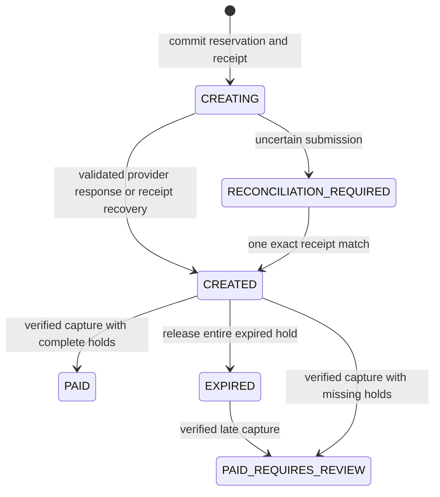

# AgentPay Nexus architecture

Updated October 11, 2026. Source and [the reliability report](RELIABILITY_REPORT.md) describe implemented behavior. Older specifications in `docs/` and `PROJECT_BLUEPRINT.md` contain historical/planned architecture and are not deployment guarantees.

## Current system

```mermaid
flowchart LR
    UI[Next.js browser workspace] --> BA[Better Auth session and origin checks]
    BA --> PX[Signed identity proxy]
    PX --> API[FastAPI role and ownership checks]
    API --> S[Sequential deterministic supervisor]
    S --> I[Catalog-grounded intent parser]
    I --> Q[Deterministic merchant pricing and persisted quote]
    Q --> P[Current policy and human approval]
    P --> C[Atomic stock and spend claim]
    C --> DB[(Commerce: SQLite or PostgreSQL)]
    C --> R[Test-only Razorpay adapter]
    R --> RP[Razorpay test API]
    RP --> WH[Raw-body signed webhook]
    WH --> V[Shared verified-capture settlement]
    R --> V
    V --> DB
    MT[In-process maintenance] --> R
    MT --> DB
    BA --> AUTH[(Separate Better Auth SQLite database)]
```

The active parser is bounded English/INR rules plus catalog selection, not general language understanding. Components named agents are sequential Python services. There is no live LLM, LangGraph, protocol-conformant MCP server, distributed worker, Redis, Kafka, or general durable workflow engine. JSON-LD is a catalog representation, not proof of an MCP integration.

## Persistence and transaction boundaries

Persisted state includes workflow idempotency records, quotes, approval gates, orders, stock reservations, payment-event deduplication, and hash-linked audit entries. Quotes, order settlement amounts, and payment events use canonical integer paise. Catalog/policy/reporting INR fields retain legacy floats for API compatibility; arithmetic/financial comparisons convert to paise, and percentage arithmetic uses Decimal.

`write_transaction` obtains a singleton database writer lock before financial decisions. PostgreSQL locks the row through an UPDATE; SQLite acquires its writer lock. This conservative serialization protects missing-key claims, policy/spend checks, approvals, settlement, and the audit head across processes. Stock updates also condition on sufficient quantity, and a savepoint rolls back partial carts. Existing database constraints deduplicate provider/payment IDs; reservation order/SKU pairs and policy ownership are unique.

An approval records a complete policy snapshot. Resume checks owner, quote state/expiry/signature, unchanged policy inputs, current stock, price drift, and strong authentication when required. Category failures cannot be overridden. Explicit human approval retains the existing soft transaction-cap, daily-spend, and upsell exception behavior under unchanged policy inputs and observed spend. Approval only prepares checkout.

Checkout commits reservation, quote consumption, provider receipt, and CREATING order before the external call. No database writer lock spans the provider request. A fresh transaction attaches a validated provider response. Timeout, cancellation, process crash, and response-persistence failure leave a durable attempt for reconciliation. There is no single transaction covering the entire workflow or external provider.

## States and recovery

The maintenance loop searches uncertain provider creation attempts by receipt without resubmitting. Zero/multiple/conflicting matches retain holds. Known-order payments are reconciled before an expiry sweep; if lookup fails, a known-order hold may expire and any later capture requires review. Unknown creation attempts are never automatically released. Sweeps are in-process and their duration grows with backlog.

Checkout verification checks owned local order and signature before fetching payment. Webhooks authenticate the raw body. Reconciliation fetches authenticated provider entities. All enter the same capture validator, checking payment/order IDs, integer amount, INR currency, captured status, and deduplication. Settlement, hold consumption, first capture-verification timestamp, and audit append commit together. Complete expected reservations determine PAID versus PAID_REQUIRES_REVIEW. Duplicate capture does not extend its spend timestamp or repeat effects.

Quotes transition from QUOTED to CHECKOUT_READY or APPROVED, then CONSUMED when an order is claimed; rejected gates cancel the quote. Workflow responses are separately persisted by idempotency key and can remain failed after an order is recovered. Authenticated order history is the checkout recovery surface.

## Verified scope and further work

SQLite and real PostgreSQL contracts, migrations, and independent-process tests passed; see [test evidence and local timing](RELIABILITY_REPORT.md). PostgreSQL is an incremental commerce configuration, not a completed multi-host deployment. Provision schema/catalog once before multiple workers; no automatic SQLite data transfer is included.

Remaining work includes finer concurrency control, durable scheduling/outbox, broader recovery/operator tools, hosted test-mode webhook verification, fully canonical legacy money storage, and multi-host auth persistence. None requires introducing Redis, Kafka, or an autonomous agent in this release. The audit chain is local tamper evidence; external anchoring is unimplemented.

An LLM intent parser remains an optional, separate pre-policy experiment. [The offline comparison harness](docs/INTENT_PARSER_EVALUATION.md) freezes the deterministic baseline and accepts later model proposals without executing checkout. Pricing, authorization, reservations, and settlement remain deterministic.

See [deployment and recovery requirements](docs/DEPLOYMENT_AND_RECOVERY.md) for migrations, provider states, operational limits, and test-mode boundaries.
